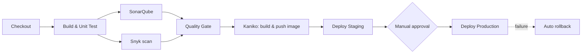

# Jenkins → Kubernetes CI/CD Pipeline

A production-style CI/CD pipeline for a **Java 21 / Spring Boot / Maven** service, built on **Jenkins** (dynamic Kubernetes agents) and deployed to **Kubernetes** with **Kustomize**. The repo includes a tiny sample service so the pipeline runs end to end out of the box. Replace it with your own code when ready.

## Pipeline at a glance



| Stage | What happens | Runs on |
|---|---|---|
| Build & Unit Test | `mvn clean verify`, JUnit + JaCoCo reports | every branch / PR |
| SonarQube + Snyk | Static analysis and dependency vulnerability scan, in parallel | every branch / PR |
| Quality Gate | Pipeline aborts if the Sonar gate fails | every branch / PR |
| Build & Push Image | Kaniko builds the image (no Docker daemon) and pushes it | `main` only |
| Deploy Staging | `kubectl apply -k k8s/overlays/staging`, waits for rollout | `main` only |
| Approve Production | Human clicks "Deploy" in Jenkins | `main` only |
| Deploy Production | Rolling update, rollout check, auto `rollout undo` on failure | `main` only |

## Repository layout

```
.
├── Jenkinsfile                 # the pipeline
├── Dockerfile                  # runtime-only image (JAR built by Maven in the pipeline)
├── pom.xml                     # Spring Boot 3.3, Java 21, JaCoCo
├── src/                        # sample service (/api/hello, /actuator/health)
├── k8s/
│   ├── base/                   # Deployment + Service
│   └── overlays/
│       ├── staging/            # namespace my-service-staging, 1 replica
│       └── production/         # namespace my-service-production, 3 replicas
└── docs/
    ├── DESIGN.md               # architecture, stage design, security, trade-offs
    ├── SETUP.md                # step-by-step Jenkins / cluster setup + checklist
    ├── RUNBOOK.md              # operations, troubleshooting, rollback
    └── adr/                    # architecture decision records
```

## Quick start

1. Read [docs/SETUP.md](docs/SETUP.md) and complete the checklist (plugins, credentials, registry secret).
2. Edit `REGISTRY` in the `Jenkinsfile` (and `APP_NAME` / namespaces if you rename the service).
3. In Jenkins create a **Multibranch Pipeline** job pointing at this repository, then add a webhook.
4. Push to `main`. The pipeline builds, scans, deploys to staging and waits for your approval.

Run the sample app locally:

```bash
mvn spring-boot:run
curl localhost:8080/api/hello
curl localhost:8080/actuator/health
```

## Documentation

- [Design document](docs/DESIGN.md)
- [Setup guide](docs/SETUP.md)
- [Runbook](docs/RUNBOOK.md)
- [Architecture decisions](docs/adr/)
- [Changelog](CHANGELOG.md)

## License

MIT, see [LICENSE](LICENSE).
