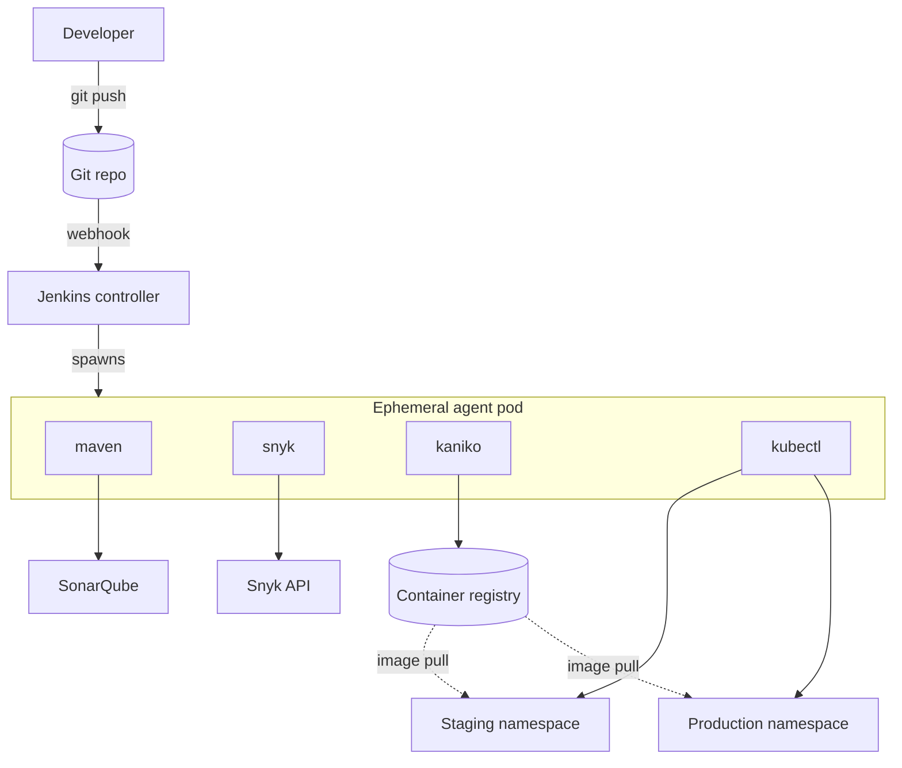

# Design Document: Jenkins → Kubernetes CI/CD

| | |
|---|---|
| Status | Accepted |
| Last updated | 2026-10-19 |
| Scope | Build, verify, package and deploy a Java 21 Spring Boot service to Kubernetes |

## 1. Goals

- Every commit is built and tested automatically; broken code never reaches an image.
- Code quality and dependency vulnerabilities are checked before anything is deployed.
- Deployments are repeatable, zero-downtime and reversible.
- Production deployments need an explicit human approval.
- Build tooling lives in disposable pods: no long-lived build servers to patch.

## 2. Non-goals

- GitOps controllers (Argo CD / Flux). See "Future work".
- Multi-cluster or multi-region rollouts.
- Provisioning the Kubernetes cluster or Jenkins itself.

## 3. Architecture

The Jenkins controller only orchestrates. Each build gets a fresh pod with one container per tool. All containers share the pod's workspace volume, so the JAR produced by `maven` is visible to `kaniko` without re-building.

## 4. Stage design

| Stage | Purpose | Failure behaviour |
|---|---|---|
| Checkout | Fetch source; compute `IMAGE_TAG = <build>-<short sha>` | Abort |
| Build & Unit Test | `mvn clean verify`; JUnit results published; JaCoCo XML for Sonar | Abort |
| SonarQube | Static analysis and coverage upload | Abort |
| Snyk | Dependency scan, high+ severity | Report-only initially; becomes blocking when `\|\| true` is removed |
| Quality Gate | Waits for Sonar's webhook result | Abort if gate is red |
| Build & Push Image | Kaniko builds `Dockerfile` using the existing JAR, pushes `registry/app:tag` | Abort |
| Deploy Staging | Kustomize apply, `rollout status` with timeout | Abort (staging only) |
| Approve Production | `input` step with 1 hour timeout | Abort on timeout or reject |
| Deploy Production | Kustomize apply, `rollout status`; `rollout undo` on failure | Auto rollback |

Image deployment stages run on `main` only; feature branches and PRs stop after the quality gate.

## 5. Image strategy

- Tag format `<build number>-<7-char commit sha>` is unique, traceable to a commit and never reused. `latest` is not used for deployments.
- The runtime image is `eclipse-temurin:21-jre-alpine`, runs as a non-root user and uses `MaxRAMPercentage=75` so the JVM respects container memory limits.
- The Dockerfile is runtime-only; Maven builds the JAR once in the pipeline (see ADR-0002).

## 6. Kubernetes design

- **Kustomize** base + per-environment overlays. Overlays set the namespace and replica count; the base holds everything common.
- **Zero downtime**: `maxUnavailable: 0`, `maxSurge: 1`, readiness probe on `/actuator/health/readiness`.
- **Self-healing**: liveness probe on `/actuator/health/liveness`.
- **Resources**: requests and limits are set so the scheduler can place pods and one pod cannot starve a node.
- **Graceful shutdown** is enabled in Spring Boot so in-flight requests finish during rollouts.

## 7. Security

| Concern | Control |
|---|---|
| Secrets | Only in Jenkins Credentials (`snyk-token`, `k8s-staging`, `k8s-prod`) and a Kubernetes Secret (`regcred`). Nothing secret is committed. |
| Image builds | Kaniko runs without a Docker socket or privileged mode. |
| Runtime | Non-root user, `runAsNonRoot: true`. |
| Supply chain | Snyk dependency scan; pinned tool image versions where possible. |
| Production access | Separate kubeconfig credential for production, plus manual approval. |

## 8. Rollback

- **Automatic**: if the production `rollout status` fails or times out, the stage's `post { failure }` runs `kubectl rollout undo`.
- **Manual**: see [RUNBOOK.md](RUNBOOK.md#rollback). Redeploying a previous build's image tag also works.

## 9. Trade-offs and risks

| Decision | Benefit | Cost / risk |
|---|---|---|
| Ephemeral agent pods | Clean, reproducible, scalable builds | Cold start of a few seconds per build; Maven cache is not shared unless a PVC is added |
| Imperative `kubectl apply` from Jenkins | Simple, no extra controller | Cluster credentials live in Jenkins; drift is not auto-corrected |
| Snyk non-blocking at first | Lets a team adopt scanning without a red pipeline | Vulnerabilities can ship until the gate is tightened |
| `sed` image substitution | No extra tooling | Edits the workspace copy only; fine because workspaces are disposable |

## 10. Future work

- Move deployment to GitOps (Argo CD or Flux) so Jenkins no longer holds cluster credentials.
- Add Trivy image scanning after the Kaniko stage.
- Add a shared Maven cache PVC and Kaniko layer cache repository.
- Canary or blue/green rollout (Argo Rollouts).
- Smoke test stage against staging before the approval gate.
